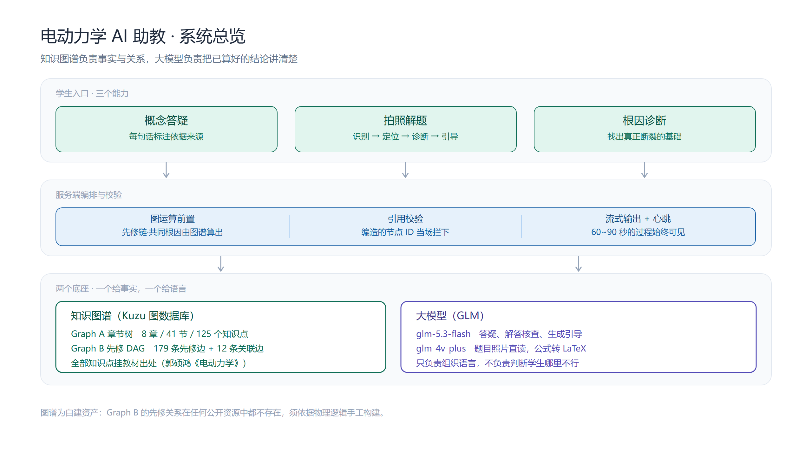
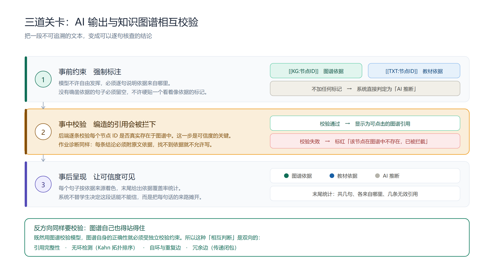
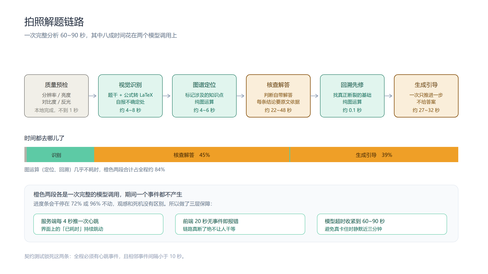
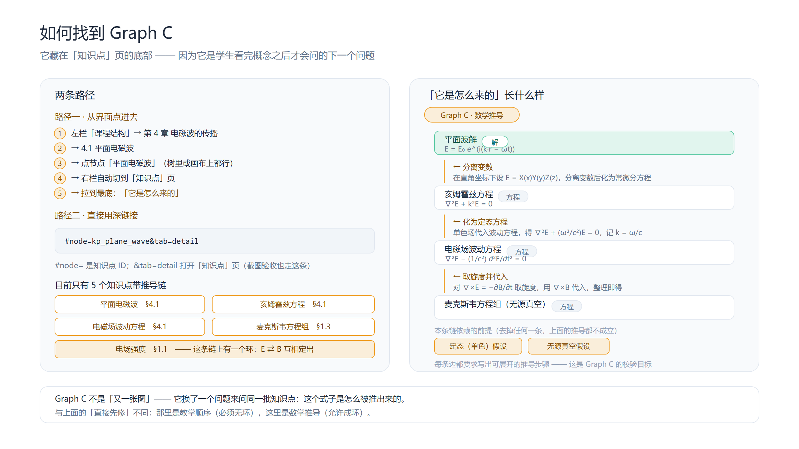
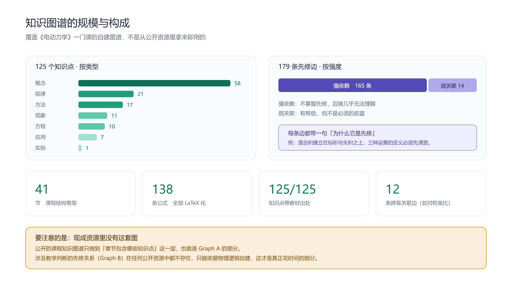
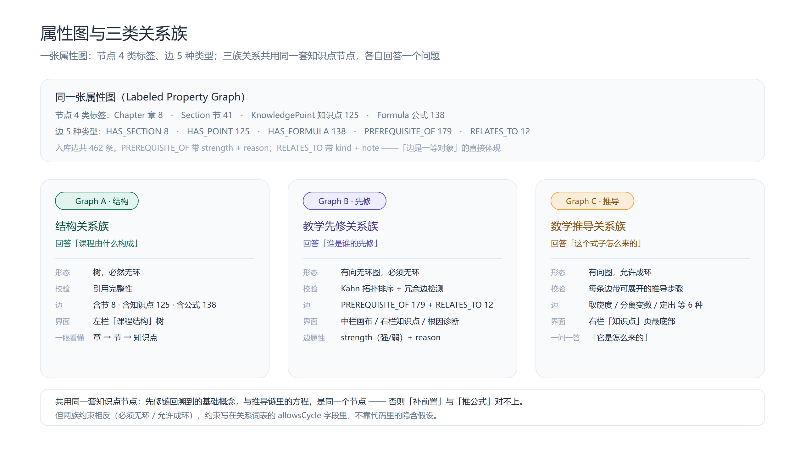
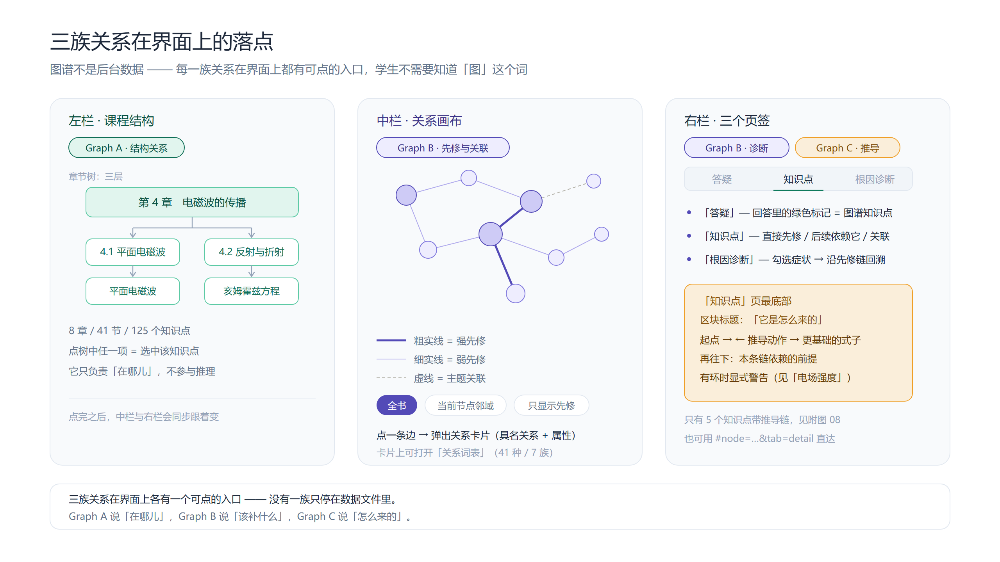
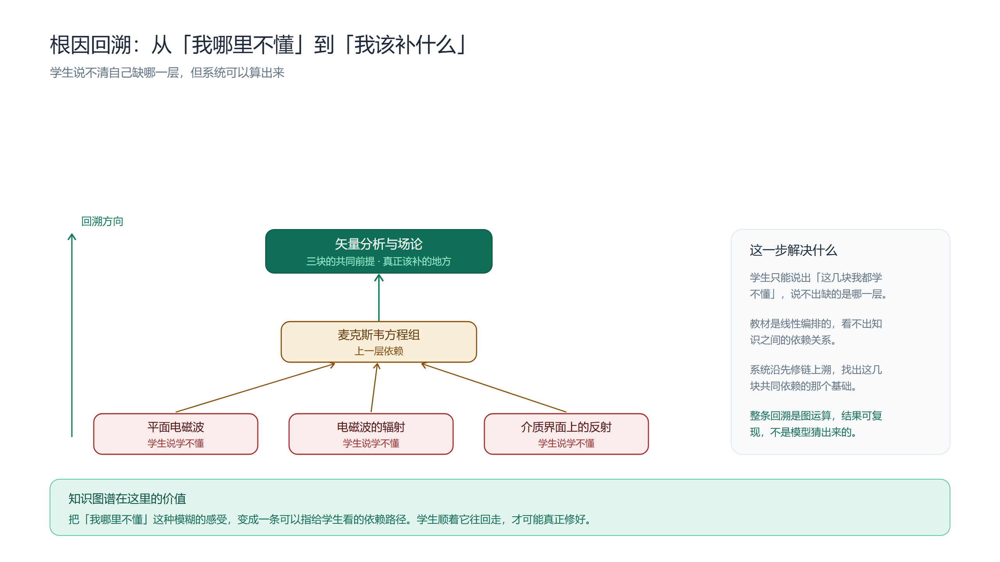

# 电动力学 AI 助教

**基于知识图谱的《电动力学》课程答疑系统。**
学生提问或拍一张题目照片，系统先在图谱里定位知识点、沿先修链回溯，再让大模型把**已经算好的结论**讲成人话——每一句都标注依据来自哪。

<p align="center">
  
</p>

> 知识图谱负责事实与关系，大模型负责把结论讲清楚。凡是能算的，绝不交给模型猜。

---

## 目录

- [三个功能](#三个功能)
- [一、概念答疑：每句话都说得出依据](#一概念答疑每句话都说得出依据)
- [二、拍照解题：不给答案，只给下一步](#二拍照解题不给答案只给下一步)
- [三、推导溯源：这个式子是怎么来的](#三推导溯源这个式子是怎么来的)
- [知识图谱](#知识图谱)
- [快速开始](#快速开始)
- [配置](#配置)
- [许可](#许可)

---

## 三个功能

| 功能 | 学生问什么 | 系统交付什么 |
|---|---|---|
| **概念答疑** | 「为什么需要位移电流？」 | 一段带**逐句依据**的回答，能看出哪句来自图谱、哪句来自教材、哪句是 AI 推断 |
| **拍照解题** | 拍一道没做出来的题 | 指出**第一个值得怀疑的地方**，并把真正断裂的基础找出来给他补 |
| **推导溯源** | 「这个式子是怎么来的？」 | 一条可回溯的推导链，从结论一路走回麦克斯韦方程组 |

三者在同一个窗口里完成，不用来回切换。

---

## 一、概念答疑：每句话都说得出依据

学生输入问题后，系统先在图谱里找到问题涉及的知识点，取它的邻域与先修链，把这些**已算好的事实**交给模型；模型组织语言时必须逐句标注依据：

| 标记 | 含义 |
|---|---|
| `[[KG:知识点]]` | 依据来自知识图谱 |
| `[[TXT:教材出处]]` | 依据来自教材章节 |
| 不加标记 | 系统判定为 **AI 推断** |

服务端会逐个校验被引用的知识点是否真实存在，**编造的节点 ID 当场拦下**，绝不放进回答里。

<p align="center">
  
</p>

呈现时用**逐句着色 + 依据覆盖率统计**：一眼能看出这段话有多少句有据可查。判断权交给学生——系统不替他说「你可以信」。

---

## 二、拍照解题：不给答案，只给下一步

拍照入口是答疑输入框左侧的 **＋** 按钮，识别结果与后续引导都落在同一个对话流里，做完还能在同一段上下文里接着追问。

<p align="center">
  
</p>

一次完整分析 **60~90 秒**，分五步：识别题干（公式转 LaTeX）→ 图谱定位知识点 → 核查学生自带解答 → 回溯先修链找根因 → 生成引导。全程有阶段进度与心跳，长等待始终可见，不会"看着像卡死"。

**三条边界，决定了它什么时候不该开口：**

- **只看，不改。** 识别环节如实转写看到的内容，不判断题目是否合理、不修正错别字、不替学生补全公式。否则下游诊断就失去了基准。
- **看不清就不批评。** 模型自报不确定的地方不允许作为判错依据；关键步骤看不清时直接说「这里没认出来，请重拍」，而不是猜着批改。
- **只引导，不给答案。** 指出第一个可疑处、反问一个更基础的问题、让他自己核验量纲与特例——但不写完整推导，不给最终结果。

> 一次只处理一道题。图里有多道题时会提示「请一题一图」，但不会硬拒绝——判断图里有几道题本身也可能出错。

**上传前还会先在本地做一次质量预检**（分辨率 / 亮度 / 对比度 / 反光 / 阴影，几百毫秒），照片不合格先提醒重拍，省掉一次 90 秒的空跑。

---

## 三、推导溯源：这个式子是怎么来的

学生对某个式子追问「它是怎么来的」，系统沿**数学推导链**反向回溯：这个结论由哪些前提、经过哪些运算得来，一直走到源头。

<p align="center">
  
</p>

推导链和先修链是两回事：

| | 先修链 | 推导链 |
|---|---|---|
| 回答 | 「我该先学什么」 | 「这个结论怎么推出来的」 |
| 方向 | 向上找**前提知识** | 向上找**数学前提** |
| 能否成环 | 不能（绕成圈就是循环论证） | **可以**（E ⇄ B 互定、ω ⇄ k 是物理事实） |

所以两类关系必须分开建，不能硬塞进同一张无环图。

---

## 知识图谱

本项目最大的资产是**自建的课程图谱**，不是从公开资源拿来即用的：

<p align="center">
  
</p>

- **125 个知识点**，按 7 种类型（概念 / 规律 / 方法 / 现象 / 方程 / 应用 / 实验）与 3 个难度档位标定，**全部挂有教材出处**
- **179 条先修边**（强依赖 165 / 弱关联 14），每条都带一句「为什么它是前置」
- **12 条跨章关联边**，把散落在不同章节、物理上互相印证的知识点连起来
- 覆盖 8 章 41 节，对齐郭硕鸿《电动力学》（第三版）

同一张图上承载**三类关系**，共用同一套知识点节点，各答一问：

<p align="center">
  
</p>

| 关系族 | 回答 | 形态 |
|---|---|---|
| 结构 | 由什么构成 | 树：章 → 节 → 知识点 |
| 教学先修 | 该先补什么 | 有向无环图 |
| 数学推导 | 这个式子怎么来的 | 有向图（允许成环） |

**每一族都在界面上有落点**，学生不需要知道「图」这个词：

<p align="center">
  
</p>

<p align="center">
  
</p>

学生只能说出「这几块我都学不懂」，系统沿先修链上溯，找出它们**共同依赖的那一层基础**，指给他看该补哪里——这一步是图运算算出来的，不是模型猜的。

更多结构图见 [`docs/diagrams/index.html`](docs/diagrams/index.html)。

---

## 快速开始

**环境要求**：Node.js ≥ 18。无需 Docker，无需 Python。

```bash
git clone https://github.com/ggg1104cloud/Knowledge-Graph-Electrodynamics-AI-Teaching-Assistant.git
cd Knowledge-Graph-Electrodynamics-AI-Teaching-Assistant
npm install

# 配置密钥（否则答疑与拍照功能不可用）
cp .env.example .env        # Windows: copy .env.example .env
# 编辑 .env，填入 GLM_API_KEY

npm start
```

打开 http://localhost:3200 。首次启动会自动建库。

> 没有密钥也能启动、浏览图谱与界面，只是调用模型的功能会提示「缺少环境变量」。

常用命令：

```bash
npm start        # 启动（首次自动建库）
npm run stop     # 优雅停止
npm run check    # 校验图谱数据
npm run diagrams # 重新导出结构图
```

---

## 配置

复制 `.env.example` 为 `.env` 后填写：

| 变量 | 必需 | 说明 |
|---|---|---|
| `GLM_API_KEY` | ✅ | 智谱 GLM 密钥，[申请地址](https://open.bigmodel.cn) |
| `GLM_MODEL` | | 对话模型，默认 `glm-5.3-flash` |
| `GLM_VISION_MODEL` | | 视觉模型，默认 `glm-4v-plus`（拍照解题用，与上面共用同一个 Key） |
| `PORT` | | 服务端口，默认 `3200` |
| `EM_KUZU_DIR` | | 图数据库文件目录，需为纯 ASCII 路径 |

---

## 许可

本项目以 **MIT License** 发布，见 [`LICENSE`](LICENSE)。

第三方数据与组件（SPHERE、graphysics 调研素材，KaTeX）的来源与许可见 [`NOTICE.md`](NOTICE.md)。
图谱结构对齐郭硕鸿《电动力学》与国家高等教育智慧教育平台同名课程，**不含教材原文**。
